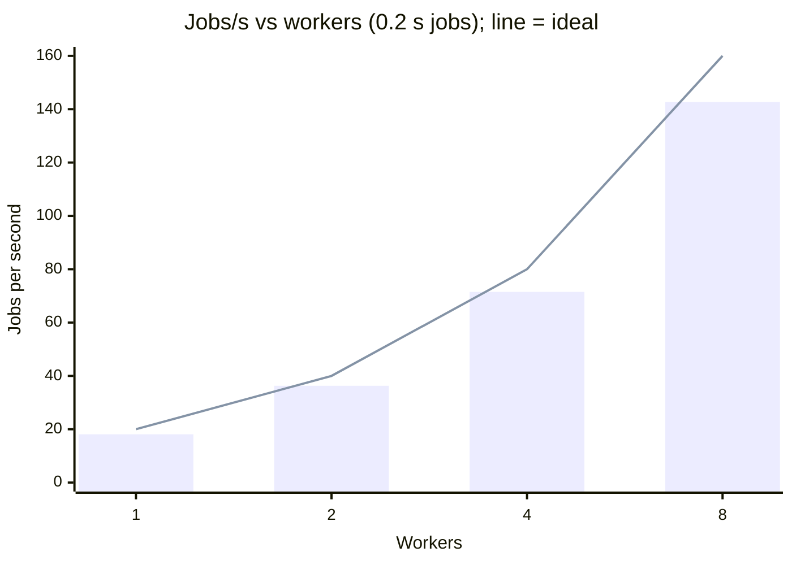

# TaskMaster

Distributed job processing platform. Postgres is the source of truth, Redis Streams carries the
work, and a **transactional outbox** keeps the two consistent. The queue mechanics (claiming,
retries, idempotency) are implemented here rather than hidden in Celery; see
[ADR 0001](docs/adr/0001-own-queue-not-celery.md).

New here? [How TaskMaster works](docs/how-it-works.md) explains the design in plain language,
with examples.

## TODO:
- Folder/file structure improvements
- Base for database crud functions
- Grafana improvements 
- Prometheus improvements
- Ratelimiting improvements
- Webhooks
- Many small improvements

## Architecture

```
 POST /jobs
     │
     ▼
 ┌────────┐  one transaction  ┌──────────────────────────┐
 │  API   │──────────────────▶│ PostgreSQL               │
 └────────┘                   │  jobs │ job_attempts │   │
                              │  outbox                  │
                              └────────────┬─────────────┘
                                 ▲         │ FOR UPDATE SKIP LOCKED
                                 │         │ + LISTEN/NOTIFY
                                 │         ▼
                                 │   ┌────────────┐
                                 │   │   Relay    │  (N instances)
                                 │   └─────┬──────┘
                                 │         │ XADD
                                 │         ▼
                                 │   ┌────────────────────────────┐
                                 │   │ Redis Streams              │
                                 │   │  taskmaster:jobs   (work)  │
                                 │   │  taskmaster:events (done)  │
                                 │   └─────┬──────────────────────┘
               state + outbox    │         │ XREADGROUP (consumer group)
               (one transaction) │         ▼
                                 │   ┌────────────┐      ┌───────────────────────┐
                                 └───│  Workers   │─────▶│ Object storage (S3)   │
                                     └─────┬──────┘      │  uploads/  results/   │
                       CPU-heavy jobs run  │             └───────────▲───────────┘
                       in a subprocess ────┘                         │
                                          presigned PUT/GET: clients ┘
```

- **API** writes the job **and** a `job.created` outbox row in one transaction. It never talks to
  Redis, so it keeps accepting jobs during a Redis outage.
- **Relay** publishes committed outbox rows to Redis. `NOTIFY` wakes it immediately and polling is
  the fallback. Several relays can run in parallel thanks to `SKIP LOCKED`.
  ([ADR 0002](docs/adr/0002-transactional-outbox.md))
- **Object storage** (S3 API; RustFS in compose) holds input and output files. Clients upload
  and download with presigned URLs, so file bytes never pass through the API
  ([ADR 0005](docs/adr/0005-files-and-cpu-work.md)).
- **Workers** claim a job with a conditional `UPDATE … WHERE status IN ('queued','retrying')`, so
  duplicate deliveries are no-ops ([ADR 0003](docs/adr/0003-at-least-once-delivery.md)). The
  result, the attempt record and the next event (`job.succeeded`, `job.retry_scheduled` with a
  backoff delay, or `job.dead`) commit together.

### Job lifecycle

```
queued ──▶ running ──▶ succeeded
  ▲           │
  │           ├──▶ retrying ──(backoff elapsed, re-dispatched)──▶ running ...
  │           ├──▶ dead        (attempts exhausted or PermanentError) ──▶ dead-letter stream
  │           ├──▶ cancelled   (POST /jobs/{id}/cancel; running jobs stop at the next heartbeat)
  └───────────┘    released    (graceful shutdown timed out; attempt not consumed)

dead / cancelled ──(POST /jobs/{id}/retry)──▶ queued
```

Every attempt is stored in `job_attempts` (`failed`, `lost`, `released`, `cancelled`,
`succeeded`), so the full history survives retries and crashes.

All of these status changes live in one module, `taskmaster/jobs/lifecycle.py`. It holds a table
of allowed moves, and every change also stages its outbox event in the same transaction. The API,
the worker and the lease sweeper all call it; none of them change a job's status themselves.


### What happens when things fail

| Failure | What recovers it |
|---|---|
| API crashes mid-request | Job row and `job.created` event commit atomically, or neither does |
| Client retries `POST /jobs` after a timeout | `Idempotency-Key` header returns the original job (200 + `Idempotent-Replayed`) |
| Redis is down | API keeps accepting jobs; relay records the error and publishes when Redis is back |
| Relay crashes after `XADD`, before commit | Event is published again; workers drop the duplicate at the claim |
| Worker dies after reading, before claiming | `XAUTOCLAIM` hands the message to another consumer |
| Worker dies mid-job (`kill -9`, OOM) | Lease stops being renewed; the sweeper retries the job (attempt marked `lost`) |
| Worker is alive but cut off from Postgres | Its lease expires and the job is reassigned; its late writes are rejected by the ownership check |
| Worker is shut down (deploy) | Running jobs get 20s to finish, then are released without using an attempt |
| Redis loses stream data | Jobs queued with no pending event for 10 min are re-dispatched |
| Handler keeps failing | Exponential backoff, then `dead` + dead-letter stream; redrive with `POST /jobs/{id}/retry` |
| A duplicate message arrives during a retry's backoff | The claim checks `next_attempt_at`, so the retry still waits |
| Postgres or object storage unreachable | API answers 503 + `Retry-After` (not 500); connections time out instead of hanging |
| Network drops a Redis connection silently | Socket timeouts and TCP keepalive turn it into an error that is retried |

Design notes: [ADR 0004](docs/adr/0004-leases-heartbeats-and-recovery.md).

## Quick start

Requires Docker with Compose v2.

```bash
docker compose up --build
```

```bash
curl -X POST localhost:8000/jobs -H "Content-Type: application/json" \
  -d '{"type": "echo", "payload": {"data": {"hello": "world"}}}'
```

Then `GET localhost:8000/jobs/<id>`. Interactive API docs are at http://localhost:8000/docs.

Try the retry path: `{"type": "flaky", "payload": {"fail_rate": 1}}` fails every attempt and ends
up `dead` after 4 attempts. Its history is at `GET /jobs/<id>/attempts`.

Try crash recovery: submit `{"type": "sleep", "payload": {"seconds": 60}}`, then
`docker compose kill -s SIGKILL worker`. After the lease expires (~35s), the job is retried
elsewhere and the attempt shows up as `lost`.

| Endpoint                     | Purpose                                                        |
|------------------------------|----------------------------------------------------------------|
| `POST /jobs`                 | Submit a job (payload validated against the task's model). Optional `Idempotency-Key` header |
| `GET /jobs/{id}`             | Job status and result                                          |
| `GET /jobs/{id}/attempts`    | Per-attempt history                                            |
| `POST /jobs/{id}/cancel`     | Cancel: immediately if queued (200), at the next heartbeat if running (202) |
| `POST /jobs/{id}/retry`      | Redrive a dead or cancelled job (`{"additional_attempts": 1}`) |
| `GET /jobs?status=&type=`    | List jobs; `?status=dead` is the dead-letter queue             |
| `GET /tasks`                 | Registered task types with their input JSON schema             |
| `POST /uploads`              | Get a presigned PUT URL for an input file of a given `size` (max 5 GiB); returns the `key` to use in a payload |
| `GET /jobs/{id}/outputs`     | Result files with presigned download URLs                      |
| `GET /health`                | Liveness: 200, or 503 when Postgres is unreachable             |

### Working with files

```bash
# 1. Ask for an upload URL, then PUT the file straight to object storage
curl -s -X POST localhost:8000/uploads -H "Content-Type: application/json"   -d "{\"filename\": \"sales.csv\", \"content_type\": \"text/csv\", \"size\": $(wc -c < sales.csv)}"
# -> {"key": "uploads/<uuid>/sales.csv", "upload_url": "http://localhost:9000/...", ...}
curl -X PUT -H "Content-Type: text/csv" --upload-file sales.csv "<upload_url>"

# 2. Submit a job that references the key
curl -s -X POST localhost:8000/jobs -H "Content-Type: application/json" -d '{
  "type": "csv.aggregate",
  "payload": {"file": "<key>", "group_by": ["region"],
              "aggregations": [{"op": "count"}, {"op": "sum", "column": "amount"}]}}'

# 3. Poll GET /jobs/<id> (see "progress"), then fetch the results
curl -s localhost:8000/jobs/<id>/outputs   # -> [{"name": "aggregate.csv", "url": "..."}]
```

| Task            | Input                                                   | Output                    |
|-----------------|---------------------------------------------------------|---------------------------|
| `csv.aggregate` | CSV; `group_by` columns; `count`/`sum`/`min`/`max`/`mean` | `aggregate.csv` + stats   |
| `image.resize`  | Image; `width`, optional `height`, `fit`/`exact`, png/jpeg/webp | `resized.<ext>`     |
| `file.checksum` | Any file; sha256/sha1/md5                               | Digest in the result      |

CSV aggregation streams the file row by row, so memory depends on the number of groups, not the
file size. CPU-heavy tasks run in a dedicated subprocess, and cancelling the job kills it.

Storage is cleaned up automatically: files from failed attempts are deleted after an hour, and
uploads after 7 days unless a job that hasn't finished still needs them. Outputs of succeeded jobs
are kept unless `TASKMASTER_OUTPUT_RETENTION_HOURS` is set. Run it by hand with
`docker compose exec worker taskmaster cleanup`.

### API keys and rate limits

```bash
docker compose exec api taskmaster apikey create --name my-app --rate-limit 300
# -> tm_1a2b3c4d_...   (shown once)
curl -H "X-API-Key: tm_1a2b3c4d_..." localhost:8000/jobs
```

- Each key sees only its own jobs; someone else's job is a 404. `GET /jobs/stats` counts yours by
  status.
- Requests are rate limited per key (default 600/min) with a token bucket in Redis, shared by all
  API replicas. Every response carries `RateLimit-Limit/Remaining/Reset`; a 429 adds `Retry-After`.
- Anonymous requests are allowed by default and limited per IP (120/min). Set
  `REQUIRE_API_KEY=true` to require keys. `taskmaster apikey list` and
  `taskmaster apikey revoke <prefix>` manage keys.
- If Redis is down the limiter fails open, so the API keeps accepting jobs.
  ([ADR 0006](docs/adr/0006-api-keys-and-rate-limiting.md))


## Observability

```bash
docker compose --profile monitoring up -d
```

- **Grafana**: http://localhost:3000 (anonymous view; admin/admin to edit). The TaskMaster
  dashboard shows throughput and error rate, run time and queue wait percentiles, queue depth by
  status, stream pending, outbox lag, recovery actions (expired leases, reclaimed messages),
  API latency per route, and 429s.
- **Prometheus**: http://localhost:9090. It scrapes the API at `/metrics/`, and every worker and
  relay replica on port 9100, found through Docker DNS, so scaling needs no config change.
- **Logs**: one JSON object per line, with `job_id`, `job_type` and `attempt` bound to every line
  logged during a job, `request_id` on API requests, and uvicorn/library logs in the same format.
  `LOG_FORMAT=console` gives readable logs.

```json
{"event": "Job 3f0c… succeeded", "job_id": "3f0c…", "job_type": "csv.aggregate", "attempt": 1, "level": "info", "logger": "taskmaster.worker", "timestamp": "2026-11-16T03:52:11.204Z"}
```

## Performance and chaos testing

Measured on one Windows laptop (Docker Desktop, everything in containers), with 4 concurrent jobs
per worker. The numbers show how it scales, not what production hardware would reach.

**Scaling with workers.** `scripts/benchmark.py`: 1,200 jobs that each sleep 0.2 s, end to end
from the first submission to the last result. Ideal is 20 jobs/s per worker.



| Workers | Jobs/s | Speed-up | Efficiency |
|---|---|---|---|
| 1 | 18.1 | 1.0× | 91% |
| 2 | 36.3 | 2.0× | 91% |
| 4 | 71.5 | 4.0× | 89% |
| 8 | 142.7 | 7.9× | 89% |

**Platform overhead.** No-op `echo` jobs, measured as how fast workers drain a backlog of 4,000
(`--prefill`, timed by the jobs' own `started_at`/`finished_at`). Each job is a claim, a result and
two outbox events, all in Postgres transactions.

| Workers | 1 | 2 | 4 | 8 |
|---|---|---|---|---|
| Jobs/s | 166 | 338 | 554 | 758 |

End to end, one API process accepts about 250–300 submissions/s, which is the ceiling for
`echo` jobs. The API is stateless, so add replicas behind a load balancer to go higher.

**API under load.** `loadtest/locustfile.py`, 50 users for 45 s (submit, poll status, list):
282 req/s, 0 failures, p50 13 ms, p95 38 ms, p99 84 ms.

**Chaos test.** `scripts/chaos.py` submits 400 jobs (0.5–3 s each), then every 2–5 s SIGKILLs or
gracefully restarts a random worker out of 4 (lease 10 s):

```
Chaos: {'graceful restart': 5, 'SIGKILL': 9} over 76s
Final job statuses: {'succeeded': 400}
Attempts by status: {'succeeded': 400, 'lost': 33}
   368  succeeded
    31  lost -> succeeded
     1  lost -> lost -> succeeded
  [PASS] all 400 jobs exist exactly once
  [PASS] all jobs succeeded
  [PASS] exactly one succeeded attempt per job
  [PASS] no pending stream messages
  [PASS] no due unpublished outbox events
```

Reproduce:

```bash
docker compose exec api taskmaster apikey create --name bench --rate-limit 10000000
uv run python scripts/benchmark.py --workers 1 2 4 8 --jobs 1200 --seconds 0.2
uv run python scripts/benchmark.py --workers 1 2 4 8 --jobs 4000 --seconds 0 --prefill
LEASE_SECONDS=10 docker compose up -d --scale worker=4 && uv run python scripts/chaos.py --jobs 400
TASKMASTER_API_KEY=<key> uv run locust -f loadtest/locustfile.py --host http://127.0.0.1:8000
```

## Writing a task

A handler gets its validated payload and a `JobContext`: `report_progress()`, `stream_input()`,
`save_output()`, a scratch `workdir`, and `run_cpu()` for CPU-bound code.

```python
from pydantic import BaseModel
from taskmaster.tasks import JobContext, PermanentError, task


class ResizeInput(BaseModel):
    url: str
    width: int


@task("image.resize", max_retries=3, timeout=60)
async def resize(payload: ResizeInput, ctx: JobContext) -> dict:
    ctx.log.info("attempt %d", ctx.attempt)
    ...
```

The first parameter's model validates the payload at submission time. Raising `PermanentError`
skips the remaining retries.

## Development

The project uses [uv](https://docs.astral.sh/uv/).

```bash
uv sync                        # create .venv with dev dependencies
uv run pytest                  # unit + integration tests (integration needs Docker: testcontainers)
uv run ruff check . && uv run ruff format --check . && uv run mypy
```

In compose, `./src` is bind-mounted: the API reloads on change. Restart the other services to pick
up changes:

```bash
docker compose restart worker relay
```

New migration after changing models:

```bash
uv run alembic revision --autogenerate -m "describe change"
```

Useful commands:

```bash
docker compose up -d --scale worker=5     # more workers
docker compose logs -f worker relay
docker compose down -v                    # stop and wipe data
```
